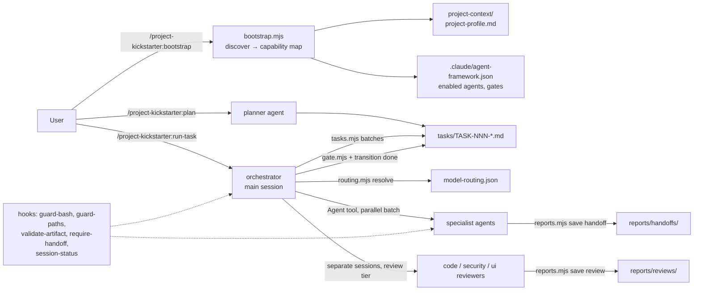

# Project Kickstarter

A Claude Code plugin with two layers:

1. **Kickstarter interview** (`/project-kickstarter:project-kickstarter`).
   Turns a raw idea into a project kit through a confidence-driven
   interview: PRD, tech stack, blueprint, UI/UX, rules, CLAUDE.md, and
   configs for nine agentic IDEs.
2. **Adaptive multi-agent engineering framework.** Covers:
   - project discovery and bootstrap;
   - a task system with lifecycle states, dependencies and handoffs;
   - an orchestrator that delegates to 24 single-responsibility agents,
     with central model routing;
   - independent code, security and UI review, with blocking gates;
   - guardrail hooks;
   - evidence-based self-improvement.

Deterministic logic (task state, gates, routing, discovery, bootstrap,
validation) lives in zero-dependency Node scripts with 75 automated tests.
Agents and skills contain only the judgment.

> **Verification status.** Every `node scripts/*.mjs`, `npm test` and
> `claude plugin validate` command in this README was run while writing
> it. Commands marked "not re-verified" or "not executed" were not run:
> install and update commands, and the v0.1 per-IDE instructions.
> Plugin slash commands and live agent dispatch
> (`/project-kickstarter:*` inside Claude Code) were **not executed**: by
> decision, no paid live evals were run. See
> [Known limitations](#known-limitations-and-unverified-behaviour).

## Contents

- [Architecture](#architecture)
- [Requirements](#requirements)
- [Installation](#installation)
- [Quick start](#quick-start)
- [Commands](#commands)
- [End-to-end workflow](#end-to-end-workflow)
- [Parallel execution](#parallel-execution)
- [Continuing in a new session](#continuing-in-a-new-session)
- [Configuration, models and permissions](#configuration-models-and-permissions)
- [Agents](#agents)
- [Security, review, UI and self-improvement workflows](#security-review-ui-and-self-improvement-workflows)
- [Script reference](#script-reference)
- [Developing this plugin](#developing-this-plugin)
- [Troubleshooting](#troubleshooting)
- [Known limitations and unverified behaviour](#known-limitations-and-unverified-behaviour)
- [Kickstarter interview and other IDEs](#kickstarter-interview-and-other-ides)
- [Updating](#updating)

## Architecture



| Layer | Path | Responsibility |
|---|---|---|
| Agents | [`agents/`](agents/) | 24 agents, one responsibility each. Least-privilege tools, model generated from routing config |
| Skills | [`skills/`](skills/) | Procedures loaded on demand: orchestration, task-planning, project-bootstrap, project-discovery, code-review, security-review (8 references), premium-ui (6 references), testing-tdd, documentation, self-improvement, handoff-protocol, project-kickstarter |
| Commands | [`commands/`](commands/) | Thin entry points: bootstrap, plan, run-task, review, security-audit, ui-audit, status, improve |
| Hooks | [`hooks/`](hooks/) | Opt-in guardrails (only active in bootstrapped projects) |
| Config | [`config/`](config/) | Agent registry and access levels, model routing, capability map, protected paths, defaults |
| Schemas | [`schemas/`](schemas/) | Task, handoff, review, proposal, framework-config |
| Scripts | [`scripts/`](scripts/) | The deterministic engine and CLIs |
| Templates | [`templates/`](templates/) | Task, handoff, review, profile, specialist agent |
| Tests | [`tests/`](tests/) | Unit and integration tests, plus 5 fixture projects |
| Docs | [`docs/architecture/`](docs/architecture/) | [Initial audit](docs/architecture/initial-audit.md), [research & decisions](docs/architecture/research-and-decisions.md), [task lifecycle](docs/architecture/task-lifecycle.md), [model routing](docs/architecture/model-routing.md), [security model](docs/architecture/security-model.md) |

The framework layer lives in the plugin and is never copied into
projects. Each bootstrapped project gets only its project layer:

- `project-context/project-profile.md`
- `.claude/agent-framework.json`
- `.claude/agent-framework/manifest.json`
- `tasks/`
- `reports/`
- `.claude/agents/<specialist>.md`, only when justified.

## Requirements

- Claude Code with plugin support. Developed against 2.1.300.
- Node.js ≥ 18.18, on `PATH`. Tested on 24.12; CI runs 18 and 22 on
  Linux and Windows.
- git. Reviewers diff against a base commit.
- Optional: Playwright or Chrome DevTools MCP, for visual verification.
  Ecosystem audit tools (`npm audit`, `pip-audit`, `osv-scanner`,
  `gitleaks`) for the security agents.

## Installation

In Claude Code (marketplace install; supports updates):

```
/plugin marketplace add milanstankovic12345/project-kickstarter
/plugin install project-kickstarter@milan-plugins
```

To try a local checkout without installing it, run this from your project
directory:

```bash
git clone https://github.com/milanstankovic12345/project-kickstarter.git
claude --plugin-dir /path/to/project-kickstarter
```

Check that the plugin loaded: `/skills` should list the
`project-kickstarter:*` skills, and `/agents` the
`project-kickstarter:*` agents. These two steps were not executed while
writing this README.

## Quick start

```
/project-kickstarter:bootstrap            # audit → plan → (approve) → apply
/project-kickstarter:status               # what exists, what can run
/project-kickstarter:plan "Add password reset via email"
/project-kickstarter:run-task             # orchestrate ready tasks
```

## Commands

| Command | Arguments | What it does |
|---|---|---|
| `/project-kickstarter:bootstrap` | `audit` \| `plan` \| `apply` \| `validate` | Discovers the project. Enables only the agents with project signals, reuses existing agents, generates justified specialists and gap tasks, and writes the profile, config and a README section. Idempotent |
| `/project-kickstarter:plan` | goal, spec path, or `findings <report>` | The planner writes one-session task files and validates them |
| `/project-kickstarter:run-task` | `TASK-ID` or `all` | The orchestrator loop: batches, dispatch, independent reviews, gate, fix loop, report |
| `/project-kickstarter:review` | `TASK-ID`, path, or empty (current diff) | Independent code review, plus architecture review for cross-module changes |
| `/project-kickstarter:security-audit` | scope | Parallel security-reviewer, dependency-auditor and threat-modeler sessions; saves to `reports/audits/` |
| `/project-kickstarter:ui-audit` | route or component | Accessibility, visual verification (when browser tools exist) and design-system consistency |
| `/project-kickstarter:status` | optional `TASK-ID` | Read-only status, runnable batch, gates, validation |
| `/project-kickstarter:improve` | focus or feedback | Evidence-based improvement proposals. Never applied without approval |
| `/project-kickstarter:project-kickstarter` | — | The original interview kickstarter |

You can also run the agents directly, e.g. "use the
project-kickstarter:security-reviewer agent on src/auth". Or run the
orchestrator as the session agent:
`claude --agent project-kickstarter:orchestrator`.

## End-to-end workflow

This walk-through uses fixture `tests/fixtures/fullstack-next` (Next.js,
Prisma, NextAuth, Stripe; no tests, no CI). The outputs below are real,
captured from the scripts that the commands call. `$PK` stands for the
plugin's `scripts/` directory.

**1. Discovery and project profile** (`/project-kickstarter:bootstrap`):

```text
$ node $PK/bootstrap.mjs plan
Enabled agents (19): accessibility-auditor, backend-engineer, code-reviewer, database-engineer, dependency-auditor, docs-writer, frontend-engineer, implementer, improvement-analyst, integration-engineer, orchestrator, planner, project-discoverer, security-reviewer, security-tester, test-engineer, threat-modeler, ui-director, visual-qa
Omitted agents (5): architect, refactoring-engineer, devops-engineer, performance-engineer, architecture-reviewer
Specialists: payments-specialist · Reused: none
Gaps: no-tests, no-ci, no-threat-model, no-design-direction, env-not-ignored
Actions: create=9 update=0 unchanged=0 conflict=0 skip=1
  create    .claude/agent-framework.json  (enabled agents, aliases, specialists, validation commands)
  create    project-context/project-profile.md  (project profile)
  create    .claude/agents/payments-specialist.md  (payment SDK detected)
  create    tasks/TASK-001-set-up-an-automated-test-framework-and-first-smo.md  (gap: no-tests)
  ...
```

`apply` writes these files and `reports/bootstrap-report.md`. A second
`apply` reports `create=0 update=0`. The value in `.env.local` never
appears in any output: secret files are listed by name only.

**2. Plan and tasks.** `/project-kickstarter:plan "<goal>"` adds tasks to
`tasks/`. Gap tasks start as `draft`. Promoting a task checks it:

```text
$ node $PK/tasks.mjs status
Tasks: 5 (draft=5)
  TASK-001  draft       test-engineer          Set up an automated test framework and first smoke test
  ...
$ node $PK/tasks.mjs transition TASK-001 in_progress
REJECTED TASK-001: draft -> in_progress
  - illegal transition draft -> in_progress (allowed: ready, cancelled)
$ node $PK/tasks.mjs transition TASK-001 ready
TASK-001: draft -> ready
```

**3. Implementation and tests.** `/project-kickstarter:run-task`:

1. The orchestrator moves the task to `in_progress`, resolves the model
   and dispatches the assigned agent with a brief that contains paths only.
2. The agent works test-first inside `files_allowed` and saves its handoff
   with `reports.mjs save handoff`.
3. The save is **rejected** if a validation command wasn't run or exited
   non-zero, or if a modified file is outside the scope.

**4. Independent review.**

```text
$ node $PK/tasks.mjs required-reviews TASK-003
code security
```

Security review is added automatically for security-sensitive scopes.
Reviewers are separate read-only sessions on the review/security tier
(`opus` by default, while implementers use `sonnet`). A review written by
the implementing agent is rejected.

**5. Security verification and the gate.** `gate.mjs check` blocks `done`
while any Critical or High finding is open, fixed but not re-verified, or
"accepted" without a matching human entry in
`project-context/risk-acceptances.md`. The fix loop is bounded by
`max_retries`, and later attempts escalate the model. When the budget runs
out, the task goes to `failed`, and reopening it requires
`--human-approved`, which triggers a permission prompt.

**6. Final report.** The orchestrator reports: tasks done, blocked and
failed; findings by severity; which batches actually ran in parallel; and
what was not verified (for example "not visually verified: no browser
tool").

## Parallel execution

- `tasks.mjs batches` computes which `ready` tasks can run **now**:
  - all their dependencies are `done`;
  - their file scopes can't overlap each other or any `in_progress` task;
  - the batch respects `concurrency.max_parallel` (default 3).
- The orchestrator sends exactly that batch as several Agent tool calls in
  **one message**. That is real concurrent execution; Claude Code runs up
  to 20 subagents concurrently.
- Everything else runs sequentially. Reviews of a single task are also
  dispatched in parallel, because they are independent and read-only.
- Overlap detection is conservative. When it can't prove two scopes are
  disjoint, the tasks run one after another.

## Continuing in a new session

Nothing depends on chat history:

1. The **SessionStart hook** prints task counts, blocked and failed
   reasons, stale in-progress tasks, and the last ledger line.
2. `/project-kickstarter:run-task` runs a preflight first:
   - it reads `reports/progress.md` and runs `tasks.mjs status`;
   - for an `in_progress` task that already has a valid handoff, it
     processes the handoff;
   - for an `in_progress` task without one, it re-dispatches it (this is
     not counted as a retry).
3. Task files, handoffs (`reports/handoffs/`) and reviews
   (`reports/reviews/`) are the authoritative state. Agents return a
   HANDOFF block of at most 15 lines, and the details live in files.

## Configuration, models and permissions

`.claude/agent-framework.json` is generated by bootstrap. It is protected:
edits ask for approval. The schema is
[`schemas/framework-config.schema.json`](schemas/framework-config.schema.json).

```json
{
  "version": 1,
  "enabled_agents": ["orchestrator", "planner", "implementer", "code-reviewer", "security-reviewer"],
  "agent_aliases": { "test-engineer": "qa-engineer" },
  "specialists": [{ "name": "payments-specialist", "tier": "security" }],
  "validation_commands": { "test": "npm test", "lint": "npm run lint" },
  "concurrency": { "max_parallel": 3 },
  "gates": { "required_reviews": ["code"] },
  "routing": { "tiers": { "coding": { "model": "opus", "fallbacks": ["sonnet"] } } }
}
```

**Model setup.** Agents map to logical tiers (reasoning, coding, fast,
review, security, ui), and the tiers map to Claude Code aliases.

```text
$ node scripts/routing.mjs table
reasoning  opus     fallbacks=sonnet  planning, architecture, orchestration, ambiguous trade-offs
coding     sonnet   fallbacks=opus  scoped implementation with clear acceptance criteria
fast       haiku    fallbacks=sonnet  mechanical work: discovery scans, docs updates, summarisation
review     opus     fallbacks=sonnet  independent code/architecture/a11y review; differs from coding tier on purpose
security   opus     fallbacks=sonnet  independent security review, threat modeling, supply chain
ui         sonnet   fallbacks=opus  UI direction and premium frontend implementation
```

Override tiers per project under `routing`. Details are in
[model-routing.md](docs/architecture/model-routing.md).

**Permissions.** Each agent's tools follow its access level in
`config/agent-registry.json`, and `validate.mjs` enforces them. For
example, reviewers have no Edit or Write, and only the orchestrator can
delegate. The recommended `.claude/settings.json` rules (deny reading
`.env`, ask before push, publish or infra commands) are in
[security-model.md](docs/architecture/security-model.md#recommended-project-permissions-claudesettingsjson).

## Agents

| Group | Agent (tier) | Access |
|---|---|---|
| Orchestration | orchestrator (reasoning), planner (reasoning), project-discoverer (fast) | delegate only / tasks / profile |
| Engineering | architect (reasoning), implementer, backend-engineer, database-engineer, test-engineer, refactoring-engineer, devops-engineer, integration-engineer (coding), frontend-engineer (ui), performance-engineer (reasoning), docs-writer (fast) | docs (architect); write (all others) |
| Review | code-reviewer, architecture-reviewer (review) | read-only + Bash |
| Security | security-reviewer, threat-modeler, dependency-auditor (security), security-tester (coding) | read-only / docs / audit / test files |
| UI | ui-director (ui), accessibility-auditor (review), visual-qa (ui) | docs / read-only (inherit MCP browser tools) |
| Improvement | improvement-analyst (reasoning) | writes proposals only |

Every agent file defines: activation, inputs, outputs, procedure,
acceptance criteria, blockers, and the shared
[handoff protocol](skills/handoff-protocol/SKILL.md). Bootstrap enables
only the agents the project needs. In the fixtures, the backend project
gets 16 agents and no UI agents, and the frontend project gets 14 and no
data or devops agents.

## Security, review, UI and self-improvement workflows

- **Code review** (`code-review` skill): every finding has a severity
  (Critical/High/Medium/Low/Info), a confidence score, a location, impact,
  a reproduction and a fix. Findings below confidence 70 are only raised
  as questions. The reviewer re-runs the validation commands, and every
  review ends with a coverage statement.
- **Security** (`security-review` skill, with references for OWASP,
  authn/authz, API, input validation, secrets, supply chain, threat
  modeling and security testing):
  - reviewers inspect the code themselves, from source to sink;
  - Critical and High findings block until fixed and re-verified, or
    accepted by a named human;
  - the framework never claims an application is secure.
- **Premium UI** (`premium-ui` skill):
  - analyse the existing product and tokens first;
  - an anti-generic checklist, full state coverage, WCAG 2.2 AA, and
    reduced motion;
  - visual claims require screenshots taken in the same session;
    otherwise the result is reported as "not visually verified".
- **Self-improvement:** `metrics.mjs summary` aggregates recorded events
  (rejected handoffs by reason, fix loops, failed tasks, findings, missing
  handoffs) and flags signals. The improvement analyst writes
  `reports/improvements/PROP-NNN-*.md` proposals, each with evidence, a
  baseline, a success metric, a version bump and a rollback.
  - Sensitive targets need `approved_by`: security policy, permissions,
    hooks, routing, global instructions.
  - Token and cost usage are **not tracked** and are never estimated.

## Script reference

All scripts accept `--root <dir>`; the default is the nearest directory
containing `.claude/agent-framework.json` or `.git`. Most also accept
`--json`.

| Script | Subcommands |
|---|---|
| `scripts/bootstrap.mjs` | `audit`, `plan` (exit 3 on conflicts), `apply [--force]`, `validate` (exit 1 on errors) |
| `scripts/discover.mjs` | prints a discovery summary; `--json` for the full document |
| `scripts/tasks.mjs` | `validate [--strict]`, `batches [--max N]`, `transition <ID> <state> [--reason] [--human-approved] [--dry-run]`, `status`, `new --title --agent --scope [--depends] [--validation "a;;b"] [--acceptance "a;;b"] [--tier] [--review]`, `required-reviews <ID>`, `next-id` |
| `scripts/reports.mjs` | `save handoff <ID>`, `save review <ID> <kind>`, `save audit <AUDIT-ID> <kind>` (all read stdin), `check handoff\|review ...`, `progress "<line>"` |
| `scripts/gate.mjs` | `check <ID>` (exit 1 when blocked) |
| `scripts/routing.mjs` | `resolve <agent> [--task ID] [--attempt N] [--unavailable a,b]`, `table`, `check`, `sync` |
| `scripts/metrics.mjs` | `summary`, `proposals` |
| `scripts/validate.mjs` | repository-wide validation of this plugin |

## Developing this plugin

```bash
npm test                                  # = node scripts/run-tests.mjs  → 75 tests, 0 failures
node scripts/validate.mjs                 # OK: 24 agents, 12 skills, 8 commands checked; 0 error(s), 0 warning(s)
node scripts/routing.mjs check            # OK: routing consistent
node scripts/sync-hook-template.mjs --check
claude plugin validate . --strict         # marketplace manifest
claude plugin validate .claude-plugin/plugin.json --strict
```

- After changing `config/model-routing.json` or `config/agent-registry.json`,
  run `node scripts/routing.mjs sync`. It rewrites `model:` and `effort:`
  in `agents/*.md`.
- After changing `hooks/lib/bash-rules.mjs`, run
  `node scripts/sync-hook-template.mjs`.
- `claude plugin validate` checks manifests only. With 2.1.300 it accepted
  agent files with invalid YAML and `model: gpt-4`, which is why
  `validate.mjs` exists.

Fixtures in `tests/fixtures/` cover a frontend app, a backend API, a
full-stack app, a project kickstarted with v0.1 (whose existing agents are
reused or aliased), and an intentionally misconfigured project. The tests
check:

- per-project agent selection;
- reuse of existing components;
- idempotency;
- conflict handling for customized files;
- profile versioning;
- deduplication of gap tasks;
- that secret values never leak;
- precise error messages for misconfigurations.

This repository dogfoods the framework. It contains its own
`.claude/agent-framework.json`, `project-context/project-profile.md`,
`tasks/` and `reports/`.

## Troubleshooting

| Symptom | Cause / fix |
|---|---|
| Hooks do nothing | The hooks are opt-in. Run `/project-kickstarter:bootstrap apply`; `.claude/agent-framework.json` must exist |
| `REJECTED … handoff: validation command not run` | The agent must run every task `validation` command and record it with its exit code |
| `scope violation` | A file outside `files_allowed` was changed. Re-plan the scope with the planner, or revert the change |
| `retry budget exhausted` | Move the task to `failed` with a reason, inspect the reviews, and reopen it with `--human-approved` (asks for permission) |
| `bootstrap plan` exits 3 | Conflicts: you customized a generated file. Diff `.claude/agent-framework/proposed/<file>` and merge, or use `apply --force` (keeps a backup) |
| Profile marked stale | Manifests or CI files changed. Re-run `bootstrap apply` (bumps `profile_version`, preserves Notes) |
| `Plain scalar contains ": "` | Quote YAML values that contain `: `. Claude Code's parser rejects them too |
| `${CLAUDE_PLUGIN_ROOT}` shows literally in a command | Agents use the plugin root given in their brief. Skills define `<plugin-root>` at the top of the file |
| A model alias isn't available to your account | Set `routing.tiers.<tier>.model` to an available alias, or use `routing.mjs resolve --unavailable <model>` to test fallbacks |

## Known limitations and unverified behaviour

- **Not executed:** live Claude sessions, plugin slash commands, real
  subagent dispatch and parallel batches inside Claude Code, skill
  auto-triggering, and `claude plugin eval`. No paid runs were made, by
  decision. The agent and skill instructions are reviewed text, not
  measured behaviour.
- **Verified by automated tests:** everything the scripts and hooks do,
  including running the hooks as processes with documented input and
  output.
- **Hooks:** Bash classification is pattern-based. It is a safety net
  against accidents, not a sandbox against an adversary. `ask` decisions
  only protect when a human sees the prompt, so avoid bypass permission
  mode. Scope enforcement uses the union of in-progress task scopes.
- **Model fallback:** fallback to another model happens when the
  orchestrator explicitly re-dispatches. Automatic runtime fallback is not
  assumed.
- **Discovery:** heuristic, from manifests, file names and config files.
  It can miss frameworks configured unusually. The scan is capped at
  20,000 files.
- **Visual verification:** this needs a browser MCP or the project's
  Playwright. Fixtures contain no runnable UI, so it was not exercised.
- **Metrics:** token, cost and latency aren't available to the framework.
- **Licensing:** the repository has no LICENSE file. Superpowers (MIT) and
  Anthropic's plugins (Apache-2.0) were studied for principles only; no
  code or text was copied (see
  [research-and-decisions.md](docs/architecture/research-and-decisions.md)).

## Kickstarter interview and other IDEs

The interview skill works in Claude Code as
`/project-kickstarter:project-kickstarter`. It also works in other agents
that read the standard `SKILL.md` format. The framework layer (agents,
hooks, commands, scripts) is Claude Code-specific. For **Cursor, Codex and
GitHub Copilot** it can be exported into the project (next section). In
other IDEs the interview falls back to its built-in templates for the agent
team and task plan.

### Framework layer in Cursor, Codex and GitHub Copilot

```bash
node scripts/export-ide.mjs <cursor|codex|copilot> --project /path/to/your-project
# then, inside that project:
node .agent-framework/runtime/scripts/bootstrap.mjs apply
node .agent-framework/runtime/scripts/tasks.mjs validate
```

Options: `--dry-run`, `--force` (keeps a backup), `--no-ci`, `--no-hooks`
(Cursor), `--install-git-hooks`, `--json`. The command is idempotent. A file
you changed after an export is never overwritten: a proposal is written to
`.agent-framework/proposed/` and the command exits 3.

How it works: the scripts do not depend on any IDE, so the exporter copies
them to `.agent-framework/runtime/` and points every exported text at that
folder. Agents and commands become each IDE's native files. The scripts keep
enforcing the task state machine, file scopes, handoffs and the review gate.

| | Cursor | Codex | GitHub Copilot |
|---|---|---|---|
| Always-on rules | `.cursor/rules/agent-framework.mdc` | marked section in `AGENTS.md` | marked section in `.github/copilot-instructions.md`, plus `.github/instructions/agent-framework-artifacts.instructions.md` |
| Roles (agents) | `.agents/skills/agent-<name>/SKILL.md`, run with `/agent-<name>` | same folder, run with `$agent-<name>` | `.github/agents/<name>.agent.md`, pick it in the agent picker |
| Commands | `.agents/skills/cmd-<name>/SKILL.md`, run with `/cmd-<name>` | same, `$cmd-<name>` | `.github/prompts/<name>.prompt.md`, run with `/<name>` |
| Guard hooks | `.cursor/hooks.json` (experimental) | none | none |
| Backstop (all) | `.github/workflows/agent-framework.yml` and, with `--install-git-hooks`, a git pre-commit hook; both run `ci-check.mjs` | same | same |

Differences from Claude Code, by design:

- **One role at a time.** These IDEs get no isolated, parallel subagents from
  the framework, so the exported orchestrator and commands tell the agent to
  take each role in turn. Reviews should run in a fresh chat. The loop is in
  `.agent-framework/runtime/docs/sequential-mode.md`. There are no parallel
  batches and no automatic model routing (Copilot agents omit `model`
  because the framework's tier names are not Copilot models).
- **Read-only roles are instructions, not permissions.** Copilot reviewers
  get no `edit` tool. In Cursor and Codex nothing stops a reviewer from
  editing, apart from the experimental Cursor hooks. The scripts still
  reject a review written by the implementing agent.
- **Cursor hooks** run the existing guards through
  `hooks/adapters/cursor.mjs`. Cursor's `preToolUse` cannot ask, so an edit
  that would need human approval (for example `.env`) is denied with a
  message to ask the user. The guards cannot tell which role is active, so
  the per-role restrictions of the Claude hooks do not apply. Shell
  commands can still be `ask`ed.
- **Not included:** Codex custom subagent files (`.codex/agents/*.toml`),
  because the documented format could not be confirmed; Codex custom
  prompts, which are user-global only; and parallel dispatch in any IDE.
- `bootstrap.mjs apply` still writes a README section that names the Claude
  Code commands. Edit it if your team does not use Claude Code.
- Cursor and Codex both use `.agents/skills/`. Exporting both into one
  project works, but the files then carry the last export's command syntax.

File formats were taken from the vendors' documentation (Cursor rules,
skills and hooks; Codex skills; Copilot custom agents, prompt files and
instructions). **Nothing has been run inside the three IDEs.** Automated
tests cover the exporter, the vendored scripts running standalone and the
Cursor adapter run as a process. Before relying on an IDE, open an exported
project in it and run one task end to end.

Usage, in order:

```
[0] Codebase analysis (if code exists)  → docs/kickstart/codebase-analysis.md
[1] Complexity tier (Quick 30q / Standard 60q / Deep 100q / Auto)
[2] Interview rounds: 4-option questions (A–D + "Other"), 5–10 per round, stops at ≥95% confidence
[3] Artifacts: PRD, techstack, blueprint, UI/UX, rules
[4] Agent team → /project-kickstarter:bootstrap (plugin) or templates (other IDEs)
[5] CLAUDE.md + AGENTS.md + per-IDE configs + hooks
[6] Tasks → tasks/TASK-NNN-*.md via task-planning (plugin) or docs/tasks.md (other IDEs)
[7] Handoff → /project-kickstarter:run-task
```

Answer with short codes (`1B 2A 3C…`), pick **E) Other** for free text,
or say **"proceed"** to accept the current state. The remaining unknowns
are then recorded as `[ASSUMPTION]` items.

The per-IDE install instructions below come from v0.1. They were not
re-verified during this upgrade, so check each tool's current
documentation.

Universal one-liner (requires Node.js; not re-verified):

```bash
npx skills add milanstankovic12345/project-kickstarter
```

### 1. Claude Code (skill only, without the framework)

Manual copy:

```bash
git clone https://github.com/milanstankovic12345/project-kickstarter.git
mkdir -p ~/.claude/skills
cp -r project-kickstarter/skills/project-kickstarter ~/.claude/skills/
```

### 2. Cursor

Cursor auto-loads skills from `.cursor/skills/`, `.agents/skills/` (project)
and `~/.cursor/skills/`, `~/.agents/skills/` (global) — **plus the Claude
and Codex directories** `.claude/skills/`, `.codex/skills/`, `~/.claude/skills/`,
`~/.codex/skills/` for compatibility. So if you installed for Claude Code
(manually), Cursor already sees it.

```bash
# global
git clone https://github.com/milanstankovic12345/project-kickstarter.git ~/.cursor/skills/project-kickstarter
# project-level
mkdir -p .cursor/skills
cp -r /path/to/project-kickstarter/skills/project-kickstarter .cursor/skills/
```

**Settings notes:**
- Verify: **Cursor Settings (Ctrl+Shift+J) → Rules → "Agent Decides"**.
- Invoke manually with `/project-kickstarter` in Agent chat, or just describe
  a new project and let the agent trigger it.
- Remote/GitHub import: **Settings → Rules → Add Rule → Remote Rule
  (GitHub)** → paste the repo URL (auto-syncs updates).
- Cursor-native `hooks.json` is supported; the kickstart generates an
  equivalent hook script when it detects Cursor.

### 3. Codex CLI

```bash
# global (auto-discovered at session start)
git clone https://github.com/milanstankovic12345/project-kickstarter.git ~/.agents/skills/project-kickstarter
# or project-level
mkdir -p .codex/skills
cp -r /path/to/project-kickstarter/skills/project-kickstarter .codex/skills/
```

Alternative via the Codex marketplace CLI:

```bash
npx codex-marketplace add milanstankovic12345/project-kickstarter --skills
```

**Settings notes:**
- Verify: `ls ~/.codex/skills/project-kickstarter/SKILL.md` (or
  `~/.agents/skills/`), then start a **new** Codex session.
- Optional Codex-only metadata (`openai.yaml`) is not required.
- Codex has no native hook events — the generated kit enforces rules via
  `AGENTS.md` + CI, documented in `docs/kickstart/hooks-report.md`.

### 4. OpenCode

OpenCode discovers skills from `.agents/skills/`, `.opencode/skills/`, and
`.claude/skills/` (project) plus `~/.agents/skills/` (global).

```bash
git clone https://github.com/milanstankovic12345/project-kickstarter.git ~/.agents/skills/project-kickstarter
```

**Settings notes:**
- The skill loads on demand via OpenCode's native `skill` tool.
- Skill names must be lowercase-with-hyphens — `project-kickstarter`
  complies. Enforcement is via JS plugins/config rather than hook events.

### 5. GitHub Copilot

```bash
git clone https://github.com/milanstankovic12345/project-kickstarter.git ~/.copilot/skills/project-kickstarter
```

**Settings notes:**
- Copilot reads repository instructions from
  `.github/copilot-instructions.md` — the generated kit writes this file so
  the rules and specs of record are always loaded.
- For team repos, commit the generated `.github/` config files so every
  teammate gets them on clone.
- Hook events are not native; rules + CI enforcement is documented instead.

### 6. Antigravity

```bash
git clone https://github.com/milanstankovic12345/project-kickstarter.git ~/.antigravity/skills/project-kickstarter
```

**Settings notes:**
- ⚠️ Antigravity's skill discovery is newer and less standardized. If the
  skills path isn't picked up, check its current documentation, or use the
  `AGENTS.md` / `.agent/rules/` files the kickstart generates — those are
  Antigravity's primary configuration surface.
- Verify support at generation time; the skill never fabricates capability.

### 7. Cline

No native skill/marketplace system — use rules + workflows:

```bash
# one-time manual setup
mkdir -p .clinerules/workflows
cp /path/to/project-kickstarter/skills/project-kickstarter/SKILL.md .clinerules/workflows/kickstart.md
```

**Settings notes:**
- Invoke in chat with the workflow, or add the rules content to
  `.clinerules/*.md`.
- The generated kit writes `.clinerules/` files during Phase 5.

### 8. Windsurf

```bash
mkdir -p .windsurf/rules
cp /path/to/project-kickstarter/skills/project-kickstarter/SKILL.md .windsurf/rules/kickstarter.md
```

**Settings notes:**
- Windsurf reads `.windsurf/rules/*.md` (legacy `.windsurfrules` also works).
- No native hooks; rules-based enforcement per the generated hooks report.

### 9. Bionic (LM Studio)

Bionic is LM Studio's built-in coding agent. It loads skills from
`~/.lmstudio/skills/` (global — all your projects) and
`.agents/skills/` (project-level — the same folder Codex CLI and OpenCode
use, so one install covers both).

```bash
git clone https://github.com/milanstankovic12345/project-kickstarter.git
# global (all your Bionic projects):
mkdir -p ~/.lmstudio/skills
cp -r project-kickstarter/skills/project-kickstarter ~/.lmstudio/skills/
# or project-level (shared via repo):
mkdir -p /path/to/your-project/.agents/skills
cp -r project-kickstarter/skills/project-kickstarter /path/to/your-project/.agents/skills/
```

On Windows, the global folder is `%USERPROFILE%\.lmstudio\skills`
(e.g. `C:\Users\<you>\.lmstudio\skills\`).

**Settings notes:**
- The skill folder name must match the `name` in the `SKILL.md` front matter
  (`project-kickstarter`) — keep it unchanged when copying.
- Trigger manually by typing `@project-kickstarter` in the input box, or
  simply describe the project — Bionic invokes the skill automatically when
  its description matches your request.
- Global skills can be enabled/disabled in **Settings → Skills**
(bottom-left of Bionic). Project skills are always active.
- Bionic reads the whole skill folder, so `references/` and `templates/`
travel together with `SKILL.md` — copy the folder, not just the file.
- No native hook events and no persistent subagent files: in Phase 5,
Bionic relies on `docs/rules.md` as the source of truth, and hook
enforcement is documented in `docs/kickstart/hooks-report.md`
(rules + CI instead of hooks).

## Updating

```bash
# publish a new version (bump .claude-plugin/plugin.json and package.json together;
# validate.mjs fails if they differ)
git tag v0.2.0 && git push origin v0.2.0
```

To update an installed copy:

| Install type | Command |
|---|---|
| Claude Code plugin | `/plugin update project-kickstarter`, then restart |
| skills.sh | `npx skills update` (not re-verified) |
| Cloned directories | `git -C <clone-dir> pull` |

<!-- project-kickstarter:start -->
## Agent framework (project-kickstarter)

This repository is set up for the project-kickstarter multi-agent framework
(Claude Code plugin). Generated by bootstrap; edit outside these markers.

| Command (in Claude Code) | Purpose |
|---|---|
| `/project-kickstarter:status` | Task and review status |
| `/project-kickstarter:plan <goal>` | Decompose a goal into tasks in `tasks/` |
| `/project-kickstarter:run-task [TASK-ID]` | Execute ready tasks with specialist agents, reviews and gates |
| `/project-kickstarter:review [TASK-ID or path]` | Independent code review |
| `/project-kickstarter:security-audit [scope]` | Independent security audit |
| `/project-kickstarter:ui-audit [scope]` | UI/UX and accessibility audit |
| `/project-kickstarter:bootstrap validate` | Check framework files are consistent |

Enabled agents:

| Agent | Why |
|---|---|
| `code-reviewer` | core agent (always enabled) |
| `dependency-auditor` | dependency manifests present [rule deps] |
| `devops-engineer` | CI, containers or IaC detected [rule delivery] |
| `docs-writer` | core agent (always enabled) |
| `implementer` | core agent (always enabled) |
| `improvement-analyst` | core agent (always enabled) |
| `orchestrator` | core agent (always enabled) |
| `planner` | core agent (always enabled) |
| `project-discoverer` | core agent (always enabled) |
| `security-reviewer` | core agent (always enabled) |
| `test-engineer` | core agent (always enabled) |

Validation commands used by tasks:

- install: `npm install`
- test: `npm test`
- check: `npm run check`

Project context: `project-context/project-profile.md` · Tasks: `tasks/` · Reports: `reports/`
<!-- project-kickstarter:end -->
