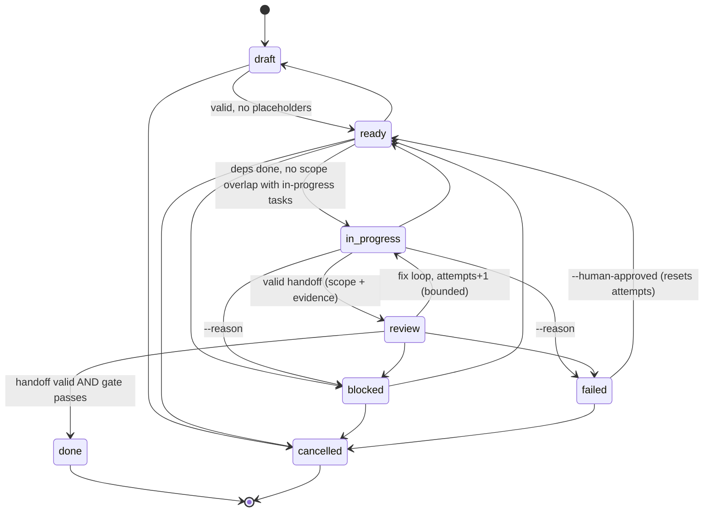

# Task lifecycle, handoffs and gates

All rules on this page are enforced by `scripts/tasks.mjs`,
`scripts/reports.mjs` and `scripts/gate.mjs`, which use the library in
`scripts/lib/`. They are covered by `tests/unit/tasks.test.mjs`,
`tests/unit/handoff-gate.test.mjs` and `tests/integration/cli.test.mjs`.

## Task file

Each task is a file at `tasks/TASK-NNN-<slug>.md`: YAML frontmatter
(schema: [`schemas/task.schema.json`](../../schemas/task.schema.json))
followed by a body with five required sections: `## Objective`,
`## Context`, `## Steps`, `## Blockers` and `## Deliverables`.

| Field | Purpose |
|---|---|
| `id`, `title` | Unique id; the file name must start with the id |
| `status` | `draft`, `ready`, `in_progress`, `review`, `done`, `blocked`, `failed`, `cancelled` |
| `agent`, `skills`, `model_tier` | Who does it, which extra skills, which routing tier |
| `depends_on` | Ids that must be `done` first. Missing ids and cycles are errors |
| `files_allowed`, `files_excluded` | The edit scope. Used for handoff scope checks, conflict detection and hook enforcement |
| `review` | Required review kinds: `code`, `security`, `ui`, `visual`, `architecture` |
| `validation` | `{cmd, expect}` list. Every command must appear in the handoff with exit code 0 |
| `acceptance` | Observable criteria |
| `max_retries`, `attempts` | Bounded fix loop, with a hard cap of 5 |
| `origin` | Generator key (e.g. `bootstrap:no-tests`), used to deduplicate generated tasks |

`tasks.mjs validate` also warns about tasks that probably won't fit in one
session: more than 15 steps, more than 10 acceptance criteria, more than 12
scope globs, or repo-wide globs. It also flags duplicate titles.

## State machine

Each transition, including rejected ones with their reasons, is appended to
`reports/metrics/events.jsonl`.

## Parallel batches

`tasks.mjs batches` returns tasks that are `ready`, have all their
dependencies `done`, and whose `files_allowed` globs can't overlap with
each other or with any `in_progress` task. The batch is capped at
`concurrency.max_parallel`, which defaults to 3.

Overlap detection is conservative: if disjointness can't be proven, the
tasks run sequentially. A wrong guess costs parallelism, never correctness.
The orchestrator sends one batch as several Agent calls in one message,
which is real concurrent execution.

## Handoff contract

The handoff lives at `reports/handoffs/TASK-NNN.md` (schema:
[`schemas/handoff.schema.json`](../../schemas/handoff.schema.json)) and is
saved through `reports.mjs save handoff`. The save is rejected, and the
candidate kept as `.rejected`, when:

- any `files_modified` entry is outside `files_allowed` or inside
  `files_excluded`;
- the status is `done` or `done_with_concerns` but no command was
  recorded, a command exited non-zero, or a task validation command
  wasn't run;
- the status is `done_with_concerns` without any risks or unresolved
  items, or `blocked` without a `blocker`.

The agent's chat reply is a HANDOFF block of at most 15 lines. The
SubagentStop hook enforces this block. The next session reads files, not
conversation history.

## Quality gate

`gate.mjs check` (also run inside `transition … done`) requires, for each
required review kind, a schema-valid `reports/reviews/TASK-NNN-<kind>.md`
that:

- was written by an agent other than the implementer;
- does not have the verdict `block`;
- has no open, `wont_fix`, unverified-fixed or improperly-accepted finding
  at `critical` or `high` severity.

Security review is added automatically when the scope touches a
security-sensitive path or is broad. Accepted findings must reference an
`RA-NNN` entry in `project-context/risk-acceptances.md` that names this
task and finding, has a human `approved_by`, a rationale, and is
unexpired. See [security-model.md](security-model.md).

## Resuming in a new session

Nothing depends on the earlier conversation. Three things carry the state:

- **SessionStart hook:** prints the task counts, blocked and failed
  reasons, stale in-progress tasks, and the last ledger line.
- **`reports/progress.md`:** an append-only ledger.
- **Task, handoff and review files:** the authoritative state.

`/project-kickstarter:run-task` runs a preflight that re-checks in-progress
tasks for existing handoffs before it dispatches anything.
